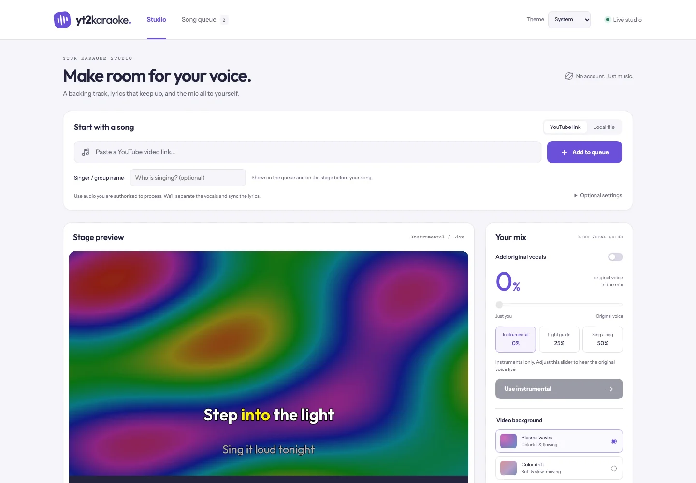

<p align="center">
  
</p>

# yt2karaoke

[](https://github.com/mbianchidev/yt2karaoke/actions/workflows/ci.yml)
[](LICENSE)
[](docs/usage.md#setup)

[Documentation](docs/README.md) · [Report a bug](https://github.com/mbianchidev/yt2karaoke/issues/new?template=bug_report.yml) · [Request a feature](https://github.com/mbianchidev/yt2karaoke/issues/new?template=feature_request.yml) · [Releases](https://github.com/mbianchidev/yt2karaoke/releases)



Your local karaoke studio. yt2karaoke turns a YouTube link or a local audio file into an **instrumental MP4 with word-synchronized lyrics**, then lets you sing over it in a browser studio with a live microphone mixer, a separate stage window, and an adjustable guide vocal. It is built for home karaoke nights, rehearsals, and anyone who wants a backing track for a song they are allowed to use.

## Contents

- [Quickstart](#quickstart)
- [Why yt2karaoke](#why-yt2karaoke)
- [How it works](#how-it-works)
- [Get started and configuration](#get-started-and-configuration)
- [Features](#features)
- [Documentation](#documentation)
- [AI policy](#ai-policy)
- [Contributing](#contributing)
- [Security](#security)
- [License](#license)

## Quickstart

Requires **Python 3.11 to 3.14** (3.14 recommended), **ffmpeg/ffprobe** in `PATH`, and **Node.js 22+ or Deno 2.3+** for YouTube links.

```bash
git clone https://github.com/mbianchidev/yt2karaoke.git
cd yt2karaoke
python3.14 -m venv .venv
source .venv/bin/activate
python -m pip install .
yt2karaoke player --port 5000
```

Open [localhost:5000](http://localhost:5000), paste a YouTube link or choose **Local file**, and select **Add to queue**. When the song shows **Ready**, press play. The first conversion downloads the AI models, so it needs internet access and takes longer.

When a [GitHub Release](https://github.com/mbianchidev/yt2karaoke/releases) is published, macOS users can run its wheel without a checkout; see [installing from a release](docs/usage.md#from-github-releases-macos). Stuck? See [Troubleshooting](docs/troubleshooting.md).

Only process media and lyrics you own or are otherwise authorized to use. The MIT License covers this software, not third-party music.

## Why yt2karaoke

- **Local and private.** Conversion runs on your machine and no account is needed. Microphone audio stays in the browser and is never recorded or uploaded.
- **Sing with a safety net.** Blend 0 to 100% of the original vocals live, or export a separate guide-vocal MP4 without re-rendering the video.
- **Lyrics you can fix.** Word timestamps are exported as editable JSON, LRC and ASS, and you can supply your own timed lyrics for local files.
- **Party-ready.** A shared queue with singer names, configurable countdowns, and a muted stage window for a second display.

Tradeoffs: separation and transcription are compute-heavy and can take minutes per song, automatic lyrics are not always accurate, AI separation can leave vocal bleed, and YouTube restricts some networks. The studio is a local server, not a hosted service.

## How it works

1. **Fetch**: yt-dlp downloads the YouTube audio, or you upload a local file.
2. **Separate**: Demucs, or an optional [track2stem](https://github.com/mbianchidev/track2stem) service, splits full-strength vocals from the instrumental.
3. **Transcribe**: Whisper finds word-level timestamps in the isolated vocals, unless you supply timed lyrics.
4. **Render**: Pillow draws animated backgrounds and highlighted lyrics, and FFmpeg encodes an H.264/AAC MP4.
5. **Perform**: the Flask + Socket.IO studio plays the instrumental video and mixes the saved vocal stem and your microphone live with Web Audio.

The frontend is plain HTML, CSS and JavaScript with self-hosted fonts: no build step or CDN. See the [module map](docs/development.md#modules) for details.

## Get started and configuration

Convert from the command line without the studio:

```bash
yt2karaoke convert --audio-file ./my-song.wav -o ./output
yt2karaoke convert "https://youtube.com/watch?v=YOUR_VIDEO_ID" --vocals-volume 0.25 -o ./output
```

Common options are `--whisper-model` (`tiny` to `large`, default `base`), `--language`, `--separation-model` (default `htdemucs`), `--visual-style` (`plasma` or `gradient`), `--lyrics-file` and `--track2stem-url`. The player accepts `--host` (default `127.0.0.1`), `--port` and `--output-dir` (default `karaoke_output`). See the [CLI, Python API and REST API reference](docs/usage.md#cli).

## Features

- YouTube links and local WAV, MP3, FLAC, M4A, OGG, AAC, MP4, WebM or AIFF files
- Instrumental MP4 with animated backgrounds and per-word lyric highlighting
- Live 0 to 100% original-vocal mix and separate vocal-mix exports
- Microphone monitoring with pitch shift, EQ and compression, plus speaker selection
- Stage window, singer names and configurable countdowns between songs
- Light, dark and system themes with keyboard-accessible controls
- LRC, ASS and timed-JSON lyric exports, a CLI, a Python API and a REST API

## Documentation

The [documentation index](docs/README.md) links the [usage guide](docs/usage.md), [troubleshooting](docs/troubleshooting.md), and the [development guide](docs/development.md) covering tests, CI, architecture and [releases](docs/development.md#publishing-releases).

## AI policy

You are responsible for everything you contribute, including AI-assisted code, documentation, and assets. Review and test your contribution. You must be able to explain what the code does and why it is needed.

## Contributing

Contributions are welcome. Read [CONTRIBUTING.md](CONTRIBUTING.md), which points coding agents to [AGENTS.md](AGENTS.md), and follow the [Code of Conduct](CODE_OF_CONDUCT.md) and [accessibility guidelines](ACCESSIBILITY.md). Every pull request runs [CI](docs/development.md#checks) (tests, JavaScript checks and package build); the live full-song YouTube test is [manual only](docs/development.md#full-song-ci).

## Security

Report vulnerabilities privately as described in [SECURITY.md](SECURITY.md). Do not open public issues for security problems.

## License

yt2karaoke is released under the [MIT License](LICENSE). Bundled fonts use the SIL Open Font License 1.1 and the Socket.IO client is MIT-licensed; their notices ship with the assets.
